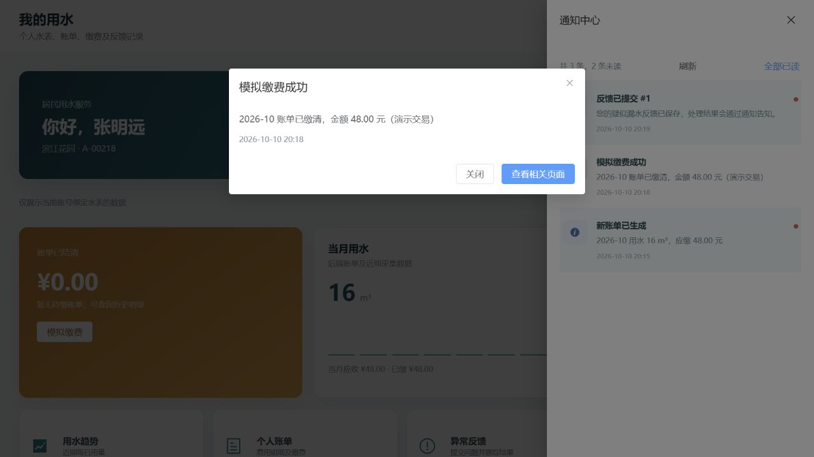
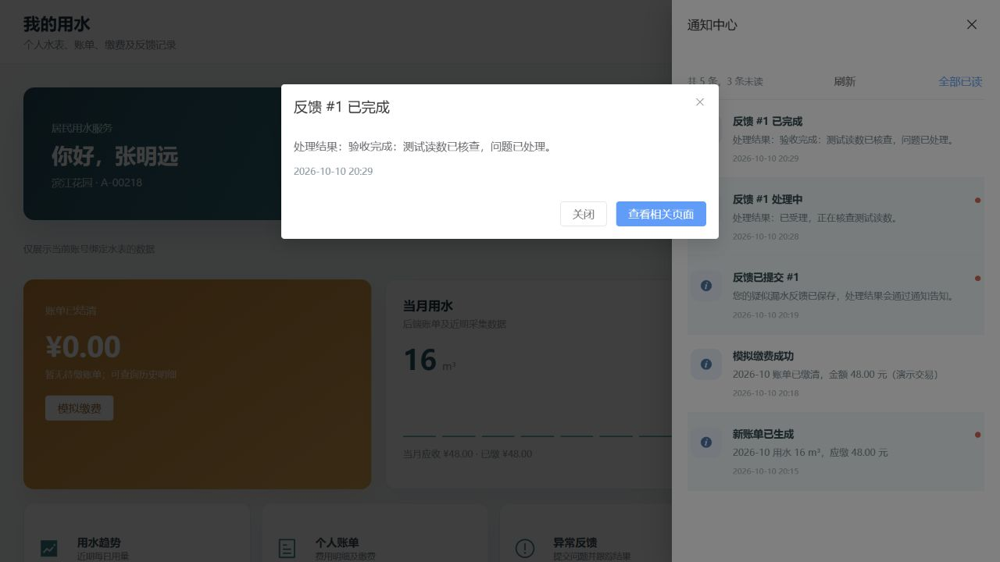

# 五项功能验收与演示指南

适用于 water-meter-java 当前 Java + Vue + SQLite 版本。用于队友联调和比赛演示；“已实现”以本地持久化业务闭环为限，不等于真实硬件、真实支付或外部大模型均已验收。

## 准备与数据保护

1. 使用根 README 的启动方式，等待前后端就绪；默认前端 http://localhost:5173，后端 http://127.0.0.1:8000。
2. 演示前停止后端、备份 SQLite，再用独立数据库副本验收。通过后端终端的 `SQLITE_PATH` 指定副本；不要删除原 water.db、覆盖原库或用多个后端同时写同一文件。
3. 默认定时模拟采集关闭、间隔 60 秒。保持关闭以控制演示数据变化，只有演示调度时短暂开启，结束后关闭。
4. 使用无真实隐私的演示资料。不要把 JWT、API Key、数据库或私密 env 放在截图/比赛材料中。
5. 初始演示密码为 admin123；已有数据库不会每次覆盖账号，请使用实际可用账号。

| 账号 | 角色 | 演示用途 |
| --- | --- | --- |
| admin | ADMIN | 全部操作、账号绑定、模拟场景、调度开关 |
| operator_east | OPERATOR | 滨江花园/江南新城设备、采集、异常、反馈；验证辖区隔离 |
| finance01 | FINANCE | 生成账单、模拟收费；验证不能设备操作 |
| auditor01 | AUDITOR | 查看只读页面；验证不能业务写入 |
| user_res_001 | USER | A-00218 本人查询、缴费、反馈与通知 |
| user_com_001 | USER，禁用 | 验证不能登录 |

建议使用普通窗口和无痕窗口分别保留管理端与用户端会话，避免在同一浏览器存储空间内反复切换账号造成混淆。

## 五项验收

### 1. 真实认证、角色隔离与真实数据

操作：

1. admin 登录进入运营总览，查看水表数、用水趋势、应收及异常；刷新后数据仍来自后端。
2. operator_east 查看水表/异常/报表，只应包含滨江花园、江南新城数据。
3. finance01 可查看并计费，但不能新增/编辑水表、启动抄表、处置异常或反馈；auditor01 只能查询。
4. user_res_001 进入个人页，仅显示 A-00218；访问管理页应被路由拦截。直接调用受限 API 也应被后端拒绝，不能只演示按钮隐藏。
5. user_com_001 登录失败；退出后业务 API 不再可用。
6. 在管理员/运营/用户三个身份分别问 AI“有哪些异常”“本月应收情况”，核对回答的范围说明与相应页面一致。

通过标准：账号和密码由数据库校验，密码为 BCrypt；返回会话不含密码；JWT 请求检查账号当前身份；普通用户及运营员不能读取越权水表/金额，未绑定 USER 不得到全局数据。浏览器只缓存 token/会话，不缓存明文密码。

接口证据：`/api/auth/login`、`/api/auth/me`、`/api/meters`、`/api/dashboard`、`/api/user/summary`、`/api/ai/query`。

边界：默认 AI 是数据库范围规则问答，外部 DeepSeek 尚未验收，不展示为“已完成大模型联调”。

### 2. 注册与管理员绑定

操作：

1. 从 /register 创建一个新的演示用户，例如 demo_20261010，填写姓名及合规密码。
2. 注册成功后进入个人页，应显示“未绑定水表”，业务数据为空，不能缴费或提交反馈。
3. 在另一管理会话中 admin 打开“账号绑定”，找到新账号，绑定一个未被其他账号绑定的水表，例如先确认 A-00219 未被占用再选择。
4. 新用户刷新个人页，显示绑定水表的真实数据；不要求重新签发 token。
5. 尝试重复绑定已属于其他账号的水表，应提示错误；自助注册不能指定 ADMIN 角色或直接绑定水表。
6. 刷新页面或重启后端后再次登录，账号与绑定仍存在。

通过标准：注册只创建 USER，管理员分配绑定，无公众直接认领他人表；重复用户名不覆盖已有密码；绑定和通知持久化。

接口证据：POST `/api/auth/register`、GET `/api/accounts`、PATCH `/api/accounts/{id}/binding`。

### 3. 自动采集与失败补抄

操作：

1. admin 或 operator_east 进入“抄表中心”，勾选“模拟一次采集失败”，点击“启动抄表”。
2. 观察“执行中 → 补抄中 → 已完成”，成功/失败/漏抄数和进度由 API 更新，不是前端定时假动画。
3. 重新查看水表累计读数、总览趋势和任务记录，确认新增读数已入库；重复提交活动任务不创建同一创建者的重复活动任务。
4. 如任务确实停在“失败待重试”，恢复可用设备/权限后点击“重试补采”，仅处理失败水表，不重复处理成功水表。
5. admin 演示定时开关：开启后等待采集任务产生，再关闭。说明间隔默认 60 秒，开关为当前进程内存设置，重启恢复启动配置。
6. 刷新页面后任务记录与进度仍存在；任务执行账号被禁用或失去辖区后，不应继续越权写读数。

通过标准：任务、目标水表、读数及重试结果落库；ADMIN 全部范围，OPERATOR 仅辖区；自动补抄一次，仍失败可手动补抄。关闭调度不会取消已提交任务。

接口证据：`/api/readings/tasks`、`/api/readings/tasks/{id}/retry`、`/api/readings/scheduler`。

边界：这是软件模拟采集器，不是已接入真实通信模块/水表。无失败待重试数据时，不要声称 UI 手动重试本轮已经实测，API 集成用例可补充证据。

### 4. 阶梯计费、账期快照与模拟缴费

操作：

1. 在完成抄表后，用 admin/finance01 打开“计费账单”，选择当前账期和可选截止日期生成账单。
2. 查看逐表明细中的用量、水费、违约金、应缴和状态。居民参考样本：18.6 m³ = 57.36 元水费（并非所有演示表都恰为该用量）。
3. 同账期再次生成，确认返回原快照，账单条数不翻倍、已有水费/违约金率/起止读数/截止日期不被覆盖；未缴违约金仍按实际逾期天数刷新。
4. 用户端只看到本人账单；选择一条待缴账单，点击“模拟缴费”，确认已缴、流水和通知同步更新。
5. 刷新后付款仍存在；API 重复提交相同幂等键，或对已缴账单使用新键，不产生第二笔付款。
6. FINANCE 可收费，OPERATOR/AUDITOR 不可收费；USER 不可支付他人账单。
7. 如果要演示逾期金额，必须在独立副本首次生成时设置合法的过去截止日期；已有快照的截止日期不会被再次生成覆盖。

通过标准：金额由服务端按真实账单计算；每表每账期只生成一次；未缴金额按实际逾期增加、已缴冻结；已缴记录不可被“重新核算”抹掉。幂等支付有持久化流水，并按数据范围查询。

接口证据：`/api/bills/recalculate`、`/api/bills/items`、`/api/bills/items/{id}/pay`、`/api/bills/payments`。

边界：当前账期生成会冻结当时采集的读数，建议先采集再生成；不能把同账期再次采集理解为自动重算。禁止未来账期；有后续账单后不能补建更早账期。付款渠道为 SIMULATED，流水 SIM- 开头，不发生真实扣款、退款或资金清算。

### 5. 异常处置、通知与反馈闭环

操作：

1. admin 在异常中心使用场景模拟，选择 A-00218 演示“设备报警”或“持续高流量”，查看新增事件及风险等级；重复同类报警不应堆积多个未关闭事件。
2. admin/辖区 operator_east 将异常从“待处理”改为“处理中”，再改为“已完成”；不能跳过状态流程。USER 只能看本人异常。
3. 用户会话打开顶栏通知，查看异常提醒和进度；打开详情标记已读，刷新后状态仍保存；其他账号不能读取或标记该通知。
4. 已绑定用户在个人页提交一条描述至少 5 字符的反馈。
5. admin 或辖区 OPERATOR 在“用户反馈”查看，改为“处理中”，填写处理结果并“已完成”；AUDITOR 只读，FINANCE 无反馈管理权限。
6. 用户刷新反馈记录及通知，确认处理结果已回传；重启后端后记录仍保留。

通过标准：读数/报警触发真实持久化异常，处置人和时间可追踪；同类未关闭事件去重；通知按收件账号隔离、已读落库；反馈按本人/辖区查询，完成必须有处理结果。正常读数不会自动擦掉未处置报警。

接口证据：`/api/readings/simulate`、`/api/anomalies`、`/api/notifications`、`/api/feedback`。

## 报表与操作日志的汇报边界

“统计报表”从已授权水表、账单及异常 API 数据汇总，可按账期/区域筛选，下载运营汇总、用水账单和异常记录 CSV。CSV 可用 Excel 打开，但不是已完成 .xlsx 导出；PDF、独立日报/周报/月报生成仍属后续工作。

关键操作已有数据库审计日志，包括注册、绑定、采集、生成账单、支付、异常处置、反馈和 AI 查询。当前没有独立操作日志检索页面或下载接口，不能把日志 UI 纳入已完成演示。

## 建议 8–10 分钟演示顺序

1. admin 登录看真实总览，operator_east 对照辖区隔离（1 分钟）。
2. 新用户注册显示未绑定，admin 绑定，用户刷新显示本人表（1–2 分钟）。
3. 启动含一次失败的采集，展示真实进度及补抄（1–2 分钟）。
4. 生成账期快照、用户模拟缴费、查看流水（2 分钟）。
5. 模拟报警、逐步处置、用户提交反馈并接收处理通知（2 分钟）。
6. 问一次范围内 AI、导出 CSV，明确尚未完成的外部大模型/硬件/真实支付/Excel PDF（1 分钟）。

## 验证记录（2026-10-10）

| 项目 | 记录 |
| --- | --- |
| 验证日期 | 2026-10-10 |
| 本机工具 | JDK 21.0.8 / Maven 3.9.16 / Node 24.21.0 / npm 11.19.0 |
| 前端 | npm run build 已通过；仅大图表 chunk 体积警告，后续可优化拆包 |
| 后端最终测试 | mvn.cmd test 通过：共 92（API 27 + 计费 62 + JWT 3），失败 0，错误 0，跳过 0 |
| 测试覆盖 | 阶梯/违约金、JWT、安全权限、绑定、通知、反馈、采集补抄、异常、模拟付款幂等、AI 数据范围 |
| 测试数据库 | API 集成测试使用独立 SQLite 文件，不连接原 water.db |
| 原库保护 | 原 backend/water.db 哈希与备份一致；本轮 UI 迁移验收在 target/ui-smoke-20261010.db 副本进行 |
| 五项 UI 结果 | 真实登录与个人范围、注册待绑定及 ADMIN 分配后刷新、60 台含失败自动补抄、本月账单与模拟支付、异常处置/反馈/通知详情均通过主要流程验收 |
| 重启保留 | 在同一测试副本重启后端后，原 JWT 仍可用，付款、账单、反馈和通知已读记录仍保留 |
| 界面检查 | 最后一次前端构建通过；最终居民页浏览器 error 日志为空；他人已绑定水表禁选（禁用账号同样计占用），本人当前水表仍可选 |
| 外部 DeepSeek | 未纳入本轮验收 |
| 未完成项 | 真硬件、真实支付/退款、.xlsx/PDF、独立日报/周报/月报、操作日志查询页面 |

2026-10-10 浏览器验收使用原库副本 `backend/target/ui-smoke-20261010.db`，前端测试端口 15173、后端 18001；这些是验收专用端口，正常启动仍使用 5173 / 8000。没有修改原 `backend/water.db`；当次验收不涉及 GitHub 上传。验收进程结束后关闭。

主要观察记录：

- admin 登录可见 60 台表；含一次模拟失败的任务最终 60/60 成功、重试次数 1。
- 当月生成 3 类账单批次、60 条明细；张明远账户只能看 A-00218，48.00 元模拟缴费后变为已缴，并生成 SIM- 流水。重启后该付款仍存在。
- 新演示用户注册后仅显示待绑定；ADMIN 分配 A-00219，原用户会话点击刷新即可显示个人 51.60 元账单，不能看到张明远的反馈。
- A-00219 持续高流量场景生成高风险事件，按待处理、处理中、已完成推进；绑定用户能看本人事件，A-00218 用户看不到该事件。
- A-00218 用户提交反馈 #1，后台受理并完成后，用户看到处理结果及通知详情；点击详情减少未读数，先前付款通知已读状态在重启后仍保留。
- 后台越权、调度启停权限、失权任务终止及手动补抄恢复由 API 集成测试验证；本轮未逐一登录所有管理角色进行完整页面遍历。

验收截图已整理到仓库的 `docs/images/`，仅含模拟演示数据，不含 JWT、密钥或真实个人资料：

截图建议只保留登录后身份、空绑定→绑定、任务成功/补抄、账单与流水、异常状态、反馈结果/已读通知。不要露出 token、Key 或真实隐私。测试总数以最终报告为准，不将预计用例数量当作实测结果。

## 交接要求

共享时交接源码、package-lock.json、说明文档与脱敏演示截图；不要提交数据库/备份、.jwt-secret、真实 API Key/JWT、.env.local 或测试临时产物。已有 SQLite 数据需要单独、受控交接；不要为方便演示删除原库。

发生登录失败/数据空时，先看前后端终端、身份绑定、实际 SQLite 路径和权限，再检查 API；不要通过删除数据库或改浏览器角色解决。启动与完整接口说明见根 README.md、backend/README.md。
